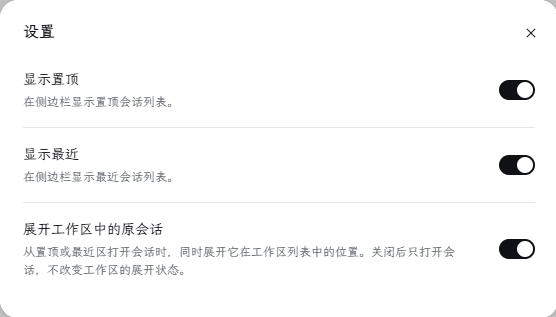

<p align="center">
  
</p>

# dsh-up-session

[简体中文](./README.md) | English

A simple DeepSeek Harness sidebar plugin: it inserts two sections, "Pinned" and "Recent", above the "Workspaces" list, gathering pinned sessions from all workspaces into one place and collecting your latest sessions into another.

<p align="center">
  
  
</p>

## Installation and compatibility

Currently supports DSH `0.2.1-rc.2`.

**Web**

```sh
dsh plugin --profile web add dsh-up-session
```

Restart DSH after installation. If you use a custom profile, replace `web` with its name.

**Desktop**

Open **Plugins** in the sidebar, click **Add plugin**, enter `dsh-up-session`, and click **Enable now** after installation.

## Pinned section

Gathers the pinned sessions of every workspace, newest activity first, and collapses like the host's own sections. Hovering a row reveals its archive and unpin buttons.

## Recent section

Sits between the pinned section and the workspaces, lists the sessions that are not pinned, newest activity first, and shows the latest five by default. It looks and collapses exactly like the pinned section. Once there are more than five sessions, a "Show more" button appears at the bottom of the list:

- each click reveals five more sessions,
- once every session is on screen the button reads "Show less",
- clicking "Show less" folds the list back to the latest five.

Hovering a row reveals its archive and pin buttons. Pinned sessions appear only in the pinned section, so no conversation is listed twice.

## Settings

Each section header carries a gear at its right edge, shown while the pointer is over the header. Clicking it opens this plugin's settings popup, styled like DSH's own settings page.

You can also open the same settings popup from the sidebar via **Plugins → Installed plugins → dsh-up-session**, then click **Open settings** on the plugin detail page.

There are three settings:

- **Show Pinned** (on by default): show or hide the entire Pinned section.
- **Show Recent** (on by default): show or hide the entire Recent section. Both lists can be turned off together and enabled again through **Open settings** on the native plugin detail page.
- **Reveal the session in its workspace** (on by default): opening a session from Pinned or Recent also expands its workspace group in the sidebar so the original row is visible. Turn it off to open the session without changing which groups are expanded.

## Status markers

Rows in both sections read the same live status as the sidebar's own session rows, so all three places always agree. When several states apply, the first one below wins:

- **amber dot**: the session is waiting for you — an answer, an approval, or a plan review;
- **spinner**: the session is running, either its own turn or a subagent it still has working;
- **green dot**: the session just finished and you have not opened it yet.

The marker sits at the left of the title and appears only when there is something to report, so an idle row keeps its original left edge; the archive and pin buttons still appear on hover where they always did.

## License

This project is licensed under the [MIT License](./LICENSE).
