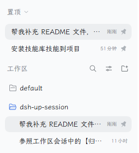
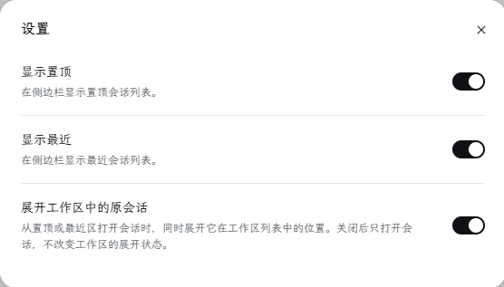

<p align="center">
  
</p>

# dsh-up-session

[简体中文](./README.md) | English

A simple DeepSeek Harness sidebar plugin: it inserts two groups, "Pinned" and "Recent", at the top of the "Workspaces" list, gathering pinned sessions from all workspaces into one place and collecting your latest sessions into another.

<p align="center">
  
  
</p>

## Installation and compatibility

**Upgrade to DSH 0.2.2-alpha.3 or later. This plugin uses the session menu API introduced in that version.**

Plugin version 1.0.4 requires DSH `>=0.2.2-alpha.3`. Installing it on an earlier DSH version may prevent DSH from starting.

**Web**

```sh
dsh plugin --profile web add dsh-up-session
```

Restart DSH after installation. If you use a custom profile, replace `web` with its name.

**Desktop**

Open **Plugins** in the sidebar, click **Add plugin**, enter `dsh-up-session`, and click **Enable now** after installation.

### Installing 1.0.3 on older DSH versions

If your DSH version is older than 0.2.2-alpha.3 and falls within plugin version 1.0.3's compatibility range (`>=0.2.1-rc.2`), install `dsh-up-session@1.0.3`.

**Web**

```sh
dsh plugin --profile web add dsh-up-session@1.0.3
```

Restart DSH after installation. If you use a custom profile, replace `web` with its name.

**Desktop**

Open **Plugins** in the sidebar, click **Add plugin**, enter `dsh-up-session@1.0.3`, and click **Enable now** after installation.

## Pinned section

Gathers the pinned sessions of every workspace, newest activity first, and collapses like the host's own sections. Hovering a row reveals its archive and unpin buttons.

Right-clicking a pinned or recent row, or focusing it and pressing the menu key or Shift+F10, opens the same session menu as a row in the workspace list: pin or unpin, rename, fork, copy the Session ID, reveal in the file manager, and archive. The items are the host's own contributions, so they stay in step with the same session further down the list. Rename is prefilled with the session's own title; an untitled session is not prefilled with the "Untitled" label.

Both Pinned and Recent sit at the top of the workspaces list as its first two groups and scroll together with the workspace groups below. While the workspace search is open, they step aside so the list can show the results.

## Recent section

Sits between the pinned section and the workspace rows, lists the sessions that are not pinned, newest activity first, and shows the latest five by default. It looks and collapses exactly like the pinned section. Once there are more than five sessions, a "Show more" button appears at the bottom of the list:

- each click reveals five more sessions,
- once every session is on screen the button reads "Show less",
- clicking "Show less" folds the list back to the latest five.

Hovering a row reveals its archive and pin buttons. The context menu is the same as in the pinned section. Pinned sessions appear only in the pinned section, so no conversation is listed twice.

## Settings

Each section header carries a gear at its right edge, shown while the pointer is over the header. Clicking it opens this plugin's settings popup, styled like DSH's own settings page.

You can also open the same settings popup from the sidebar via **Plugins → Installed plugins → dsh-up-session**, then click **Open settings** on the plugin detail page.

There are three settings:

- **Show Pinned** (on by default): show or hide the entire Pinned section.
- **Show Recent** (on by default): show or hide the entire Recent section. Both lists can be turned off together and enabled again through **Open settings** on the native plugin detail page.
- **Reveal the session in its workspace** (on by default): opening a session from Pinned or Recent also expands its workspace group in the sidebar so the original row is visible. Turn it off to open the session without changing which groups are expanded.

## Status markers

Rows in both sections read the same live status as the sidebar's own session rows, so all three places always agree. When several states apply, the first one below wins:

- **amber dot**: the session is waiting for you — an answer, an approval, or a plan review;
- **spinner**: the session is running, either its own turn or a subagent it still has working;
- **green dot**: the session just finished and you have not opened it yet.

The marker appears only when there is something to report. Idle rows reserve the same space to the left of the title, matching the workspace list's session indent and keeping titles from shifting when the status changes.

## Publishing

Publishing a GitHub Release triggers the [publishing workflow](./.github/workflows/publish.yml), which publishes the package at that tag to npm. The tag must match the version in `package.json`, for example `v1.0.1` or `1.0.1`. Stable versions use the npm `latest` tag; prerelease versions use `next` and must also be marked as prereleases on GitHub. Saving a draft or pushing a tag alone does not trigger publishing.

Before the first automated release, add a GitHub Actions trusted publisher in the npm settings for `dsh-up-session` ([official npm instructions](https://docs.npmjs.com/trusted-publishers/)):

- Organization or user: `kyrsieger`
- Repository: `dsh-up-session`
- Workflow filename: `publish.yml`
- Environment name: leave blank
- Allowed actions: allow direct publishing with `npm publish`

The workflow authenticates through OIDC, so no `NPM_TOKEN` is needed. Commit and push the workflow, version number, and changelog first, then create a tag for that commit and publish its Release. If publishing fails, rerun the failed job in GitHub Actions; npm versions that have already been published successfully cannot be published again.

## License

This project is licensed under the [MIT License](./LICENSE).
