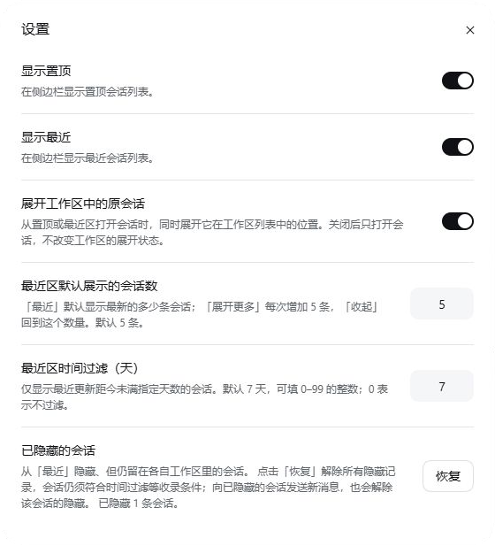

<p align="center">
  
</p>

# dsh-up-session

[简体中文](./README.md) | English

A simple DeepSeek Harness sidebar plugin: it inserts two groups, "Pinned" and "Recent", at the top of the "Workspaces" list, gathering pinned sessions from all workspaces into one place and collecting your latest sessions into another.

<p align="center">
  
  
</p>

## Installation and compatibility

**Upgrade to DSH 0.2.2-alpha.3 or later. This plugin uses the session menu API introduced in that version.**

Plugin version 1.1.0 requires DSH `>=0.2.2-alpha.3`. Installing it on an earlier DSH version may prevent DSH from starting.

**Web**

```sh
dsh plugin --profile web add dsh-up-session
```

Restart DSH after installation. If you use a custom profile, replace `web` with its name.

**Desktop**

Open **Plugins** in the sidebar, click **Add plugin**, enter `dsh-up-session`, and click **Enable now** after installation.

### Installing 1.0.3 on older DSH versions

If your DSH version is older than 0.2.2-alpha.3 and falls within plugin version 1.0.3's compatibility range (`>=0.2.1-rc.2`), install `dsh-up-session@1.0.3`.

**Web**

```sh
dsh plugin --profile web add dsh-up-session@1.0.3
```

Restart DSH after installation. If you use a custom profile, replace `web` with its name.

**Desktop**

Open **Plugins** in the sidebar, click **Add plugin**, enter `dsh-up-session@1.0.3`, and click **Enable now** after installation.

## Pinned section

Gathers pinned sessions from all workspaces, sorted by most recent activity. The section can be expanded or collapsed.

Open, archive, or unpin sessions directly, or use the context menu to manage them or reveal their original location in the workspace.

## Recent section

Lists unpinned sessions by most recent activity, without duplicating the Pinned section. By default, it shows the latest five sessions updated within the last seven days, with an option to show more. The display count and time range can be adjusted in Settings.

“Show more” displays the total number of remaining sessions in parentheses and reveals up to five more at a time. Once expanded, a separate “Show less” action appears on its right and returns to the default count in one click. Only “Show less” remains when all sessions are visible; both actions disappear when the total is at or below the default count. Archiving and other changes update the list immediately, filling vacant places from the remaining sessions to maintain the current display count where possible.

The footer uses two text buttons, “Show more (remaining count)” and “Show less”, separated by a thin vertical line. The count remains visible on hover.

Open, archive, pin, or hide sessions from Recent, or use the context menu to manage them.

## Settings

- **Show Pinned** (on by default): show or hide the Pinned section.
- **Show Recent** (on by default): show or hide the Recent section.
- **Reveal the session in its workspace** (on by default): opening a session from Pinned or Recent expands its workspace group to show the original session.
- **Sessions shown in Recent** (five by default): set the number of sessions Recent shows by default.
- **Recent time filter (days)** (7 days by default): show only sessions updated within the specified number of days; 0 disables the filter.
- **Hidden sessions**: view the number of sessions hidden from Recent and clear all hidden records at once.

## License

This project is licensed under the [MIT License](./LICENSE).
