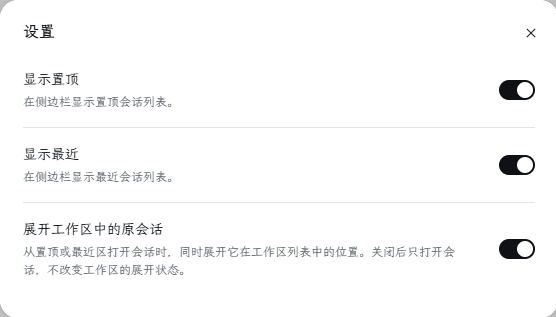

<p align="center">
  
</p>

# dsh-up-session

简体中文 | [English](./README.en.md)

一个简单的 DeepSeek Harness 侧边栏插件：在「工作区」列表顶部插入「置顶」和「最近」两个分组，把分散在各个工作区里的置顶会话汇总到一处，也把最近的会话收拢到一处。

<p align="center">
  
  
</p>

## 安装与兼容

**建议升级到 DSH 0.2.2-alpha.3 以上版本，本插件使用该版本提供的会话菜单接口。**

插件 1.0.4 的 DSH 兼容版本为 `>=0.2.2-alpha.3`，在更早的 DSH 版本上安装可能导致 DSH 无法启动。

**Web 端**

```sh
dsh plugin --profile web add dsh-up-session
```

安装后重启 DSH。如果使用自定义 profile，将命令中的 `web` 替换为对应名称。

**桌面端**

打开侧边栏「插件」，点击「添加插件」，输入 `dsh-up-session`，安装完成后点击「立即启用」。

### 在旧版 DSH 上安装 1.0.3

如果你的 DSH 版本早于 0.2.2-alpha.3，且符合插件 1.0.3 的兼容范围 `>=0.2.1-rc.2`，请指定版本安装 `dsh-up-session@1.0.3`。

**Web 端**

```sh
dsh plugin --profile web add dsh-up-session@1.0.3
```

安装后重启 DSH。如果使用自定义 profile，将命令中的 `web` 替换为对应名称。

**桌面端**

打开侧边栏「插件」，点击「添加插件」，输入 `dsh-up-session@1.0.3`，安装完成后点击「立即启用」。

## 置顶区

汇总所有工作区里被置顶的会话，按最近更新时间排序，可展开收起。每行悬停时出现归档和取消置顶两个按钮。

在置顶区或最近区的会话行上右键，或聚焦该行后按菜单键 / Shift+F10，会打开与工作区列表相同的会话菜单（置顶或取消置顶、重命名、分叉会话、复制 Session ID、在文件管理器中显示、归档）。菜单项由宿主注册，因此和下面工作区里的同一条会话保持一致。重命名对话框预填的是会话自己的标题，未命名会话不会被填成「未命名」。

置顶区和最近区都位于「工作区」列表顶部，是该列表的前两个分组，会和下方的工作区分组一起滚动；使用「工作区」的搜索功能时，两个区暂时隐藏，把列表让给搜索结果。

## 最近区

位于置顶区与工作区列表之间，按最近更新时间排序显示尚未置顶的会话，默认显示最新的 5 条，样式与置顶区一致，同样可以展开收起。默认展示多少条可在设置中调整（1–50），「展开更多」每次固定增加 5 条。会话多于当前显示的条数时，列表底部出现「展开更多」：

- 每点一次「展开更多」再显示 5 条；
- 全部会话都显示完后，按钮变为「收起」；
- 点击「收起」把列表收回到默认展示的条数。

每行悬停时出现归档和置顶两个按钮。右键菜单与置顶区相同。已置顶的会话只出现在置顶区，两区不会重复显示同一个会话。

## 设置

「置顶」和「最近」的标题栏右侧各有一个齿轮按钮，鼠标移到标题栏上才出现；点击后打开本插件的设置弹窗，样式沿用 DSH 原生设置页。

也可以从侧边栏「插件 → 已安装插件 → dsh-up-session」进入插件详情页，点击「打开设置」打开同一个设置弹窗。

目前有四项设置：

- **显示置顶**（默认开启）：显示或隐藏整个置顶区。
- **显示最近**（默认开启）：显示或隐藏整个最近区。两个列表可以同时关闭，之后仍可通过原生插件详情页的「打开设置」重新开启。
- **展开工作区中的原会话**（默认开启）：从置顶区或最近区点击会话时，同时展开它在工作区列表中所在的分组，让原生会话行可见。关闭后只打开会话，不改变工作区的展开状态。
- **最近区默认展示的会话数**（默认 5）：最近区默认显示最新的多少条会话。可填 1–50，超出范围会被拉回到最近的边界值。输入后按回车或离开输入框才生效，输入框右侧的上下按键每点一次增减 1。「展开更多」每次固定增加 5 条，不受这个数量影响。

## 许可

本项目基于 [MIT 许可证](./LICENSE) 授权。
