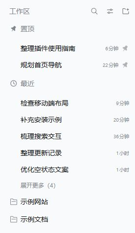
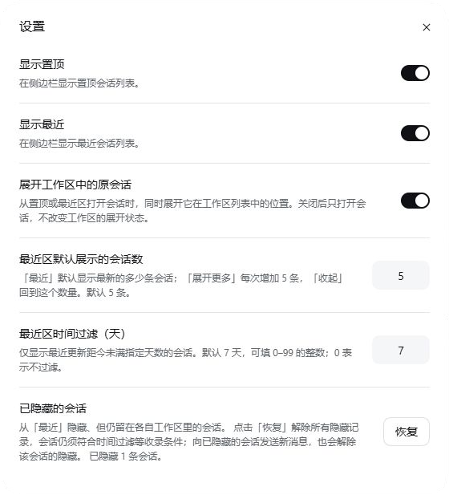

<p align="center">
  
</p>

# dsh-up-session

简体中文 | [English](./README.en.md)

一个简单的 DeepSeek Harness 侧边栏插件：在「工作区」列表顶部插入「置顶」和「最近」两个分组，把分散在各个工作区里的置顶会话汇总到一处，也把最近的会话收拢到一处。

<p align="center">
  
  
</p>

## 安装与兼容

**建议升级到 DSH 0.2.2-alpha.3 以上版本，本插件使用该版本提供的会话菜单接口。**

插件 1.1.0 的 DSH 兼容版本为 `>=0.2.2-alpha.3`，在更早的 DSH 版本上安装可能导致 DSH 无法启动。

**Web 端**

```sh
dsh plugin --profile web add dsh-up-session
```

安装后重启 DSH。如果使用自定义 profile，将命令中的 `web` 替换为对应名称。

**桌面端**

打开侧边栏「插件」，点击「添加插件」，输入 `dsh-up-session`，安装完成后点击「立即启用」。

### 在旧版 DSH 上安装 1.0.3

如果你的 DSH 版本早于 0.2.2-alpha.3，且符合插件 1.0.3 的兼容范围 `>=0.2.1-rc.2`，请指定版本安装 `dsh-up-session@1.0.3`。

**Web 端**

```sh
dsh plugin --profile web add dsh-up-session@1.0.3
```

安装后重启 DSH。如果使用自定义 profile，将命令中的 `web` 替换为对应名称。

**桌面端**

打开侧边栏「插件」，点击「添加插件」，输入 `dsh-up-session@1.0.3`，安装完成后点击「立即启用」。

## 置顶区

汇总所有工作区里的置顶会话，按最近更新时间排序，支持展开和收起。

可直接打开、归档或取消置顶会话，也可通过右键菜单管理会话或跳转到原工作区中的位置。

## 最近区

按最近更新时间排序显示未置顶的会话，与置顶区不重复。默认显示最近 7 天内更新的最新 5 条会话，可展开查看更多；显示数量和时间范围可在设置中调整。

支持打开、归档、置顶或从最近区隐藏会话，也可通过右键菜单管理会话。

## 设置

- **显示置顶**（默认开启）：显示或隐藏置顶区。
- **显示最近**（默认开启）：显示或隐藏最近区。
- **展开工作区中的原会话**（默认开启）：从置顶区或最近区打开会话时，展开其所在的工作区分组，显示原会话。
- **最近区默认展示的会话数**（默认 5 条）：设置最近区默认显示的会话数量。
- **最近区时间过滤（天）**（默认 7 天）：只显示指定天数内更新的会话，设为 0 则不过滤。
- **已隐藏的会话**：查看从最近区隐藏的会话数量，并可一键解除全部隐藏。

## 许可

本项目基于 [MIT 许可证](./LICENSE) 授权。
